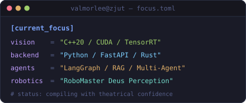
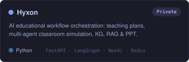
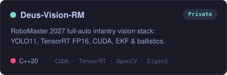
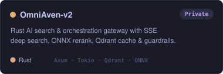
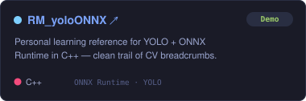
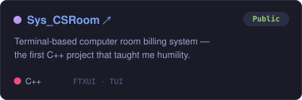
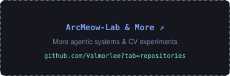
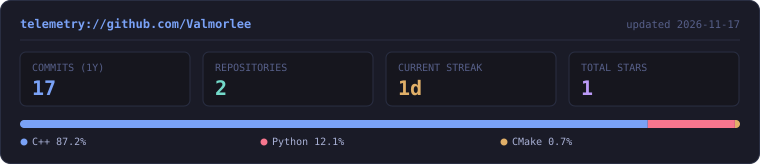

  
   
  
   
  

---

### About

<table>
<tr>
<td valign="center" width="58%">

- CS student @ **Zhejiang University of Technology**, Computer Science &amp; Technology.
- **Vision Leader** @ **ZJUTDeus** for RoboMaster 2027.
- **Tech Lead** @ **ArcMeow-Lab**, a campus innovation lab for experiments that sometimes even survive contact with reality.
- Building around **RoboMaster vision**, **CUDA/TensorRT inference**, and **multi-agent educational workflows**.
- Interested in **AI agents**, **hybrid transformer architectures**, and systems that are only slightly overengineered.
- Fun fact: my code either runs perfectly on the first try or refuses to compile with theatrical confidence.

</td>
<td valign="center" width="42%" align="center">
  
</td>
</tr>
</table>

---

### Tech Stack

  
   
  

  Also working with: <code>TensorRT</code> · <code>ONNX Runtime</code> · <code>LangGraph</code> · <code>Qdrant</code> · <code>Eigen3</code>

---

### Projects

<table>
  <tr>
    <td width="50%" align="center">
      
    </td>
    <td width="50%" align="center">
      
    </td>
  </tr>
  <tr>
    <td width="50%" align="center">
      
    </td>
    <td width="50%" align="center">
      
    </td>
  </tr>
  <tr>
    <td width="50%" align="center">
      
    </td>
    <td width="50%" align="center">
      
    </td>
  </tr>
</table>

---

### Telemetry &amp; Activity

  

  <picture>
    <source media="(prefers-color-scheme: dark)" srcset="https://raw.githubusercontent.com/Valmorlee/Valmorlee/output/github-contribution-grid-snake-dark.svg" />
    <source media="(prefers-color-scheme: light)" srcset="https://raw.githubusercontent.com/Valmorlee/Valmorlee/output/github-contribution-grid-snake.svg" />
    
  </picture>

